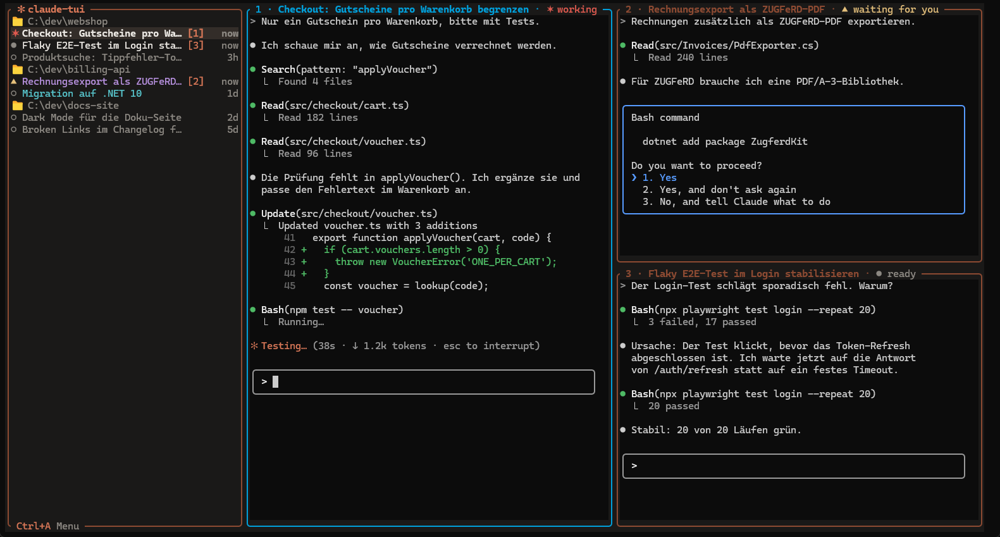

# claude-tui

Ein Terminal-Arbeitsplatz für mehrere Claude-Code-Sessions, geschrieben in Rust. Links eine
Seitenleiste mit allen Sessions und ihrem Zustand (working, waiting for you, ready),
rechts bis zu vier Sessions in echten PTYs. Die Idee stammt von
[herdr](https://github.com/ogulcancelik/herdr); Code ist nicht übernommen.



Bis zu 4 Fenster nebeneinander, Fokuswechsel mit `Ctrl+Pfeil`, alle Befehle im `Ctrl+A`-Menü, das
über dem Bereich mit dem Fokus erscheint.

## Aufbau

| Ordner | Inhalt |
|---|---|
| `src/` | Rust-Quellcode; `Cargo.toml` liegt im Wurzelordner |
| `docs/` | Dokumentation: [Bedienung](docs/bedienung.md), [Architektur](docs/architektur.md), [Build & Release](docs/release.md), [Code-Richtlinien](docs/code-richtlinien.md) |

## Installieren

Fertige Programme für Windows, Linux und macOS gibt es unter
[Releases](https://github.com/NicoMertens/claude-tui/releases) — je Plattform eine einzelne Datei
`claude-tui-v<Version>-<Ziel>[.exe]`. Herunterladen (unter Linux/macOS `chmod +x`), dann:

```
claude-tui install     # kopiert sich an einen festen Ort und trägt ihn in den PATH ein
```

Danach startet `claude-tui` in jedem neuen Terminal. Unter Windows landet es in
`%LOCALAPPDATA%\Programs\claude-tui` (Benutzer-PATH, keine Adminrechte), unter Linux/macOS in
`~/.local/bin`. Windows in einem Schritt (PowerShell):

```powershell
$exe = "$env:TEMP\claude-tui.exe"
$url = (irm https://api.github.com/repos/NicoMertens/claude-tui/releases/latest).assets |
  ? name -like '*x86_64-pc-windows-msvc.exe' | % browser_download_url
iwr $url -OutFile $exe; & $exe install
```

**Updates:** claude-tui schaut beim Start höchstens einmal am Tag auf GitHub nach einer neuen
Version und zeigt sie in der Menübox an (`Ctrl+A u` installiert sie). Von Hand: `claude-tui update`.
Abschalten: Umgebungsvariable `CLAUDE_TUI_NO_UPDATE_CHECK=1`. Entfernen: `claude-tui uninstall`.

`install`, `update` und `uninstall` gibt es ab v0.2.0.

## Selbst bauen

```
cargo run --release    # bauen und starten, jede Session startet `claude`
```

Die gebaute App liegt danach unter `target/release/claude-tui`.

## Lizenz

[MIT](LICENSE)
